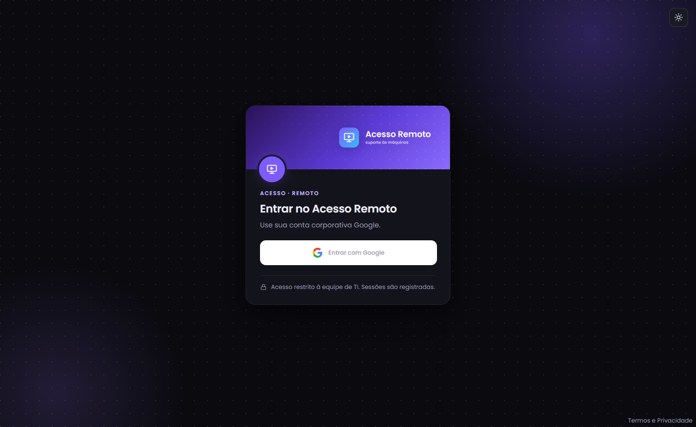
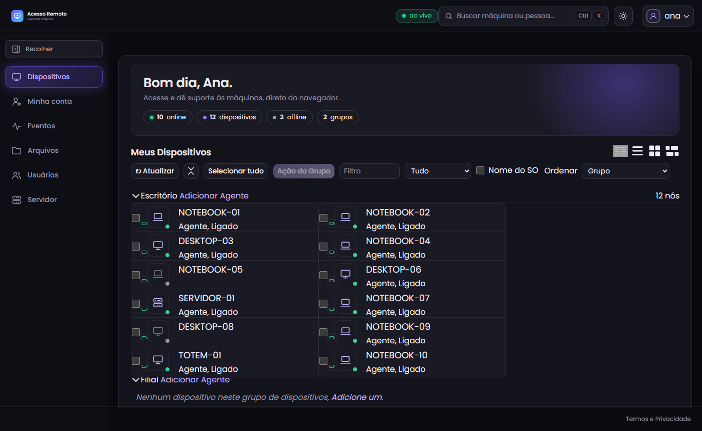
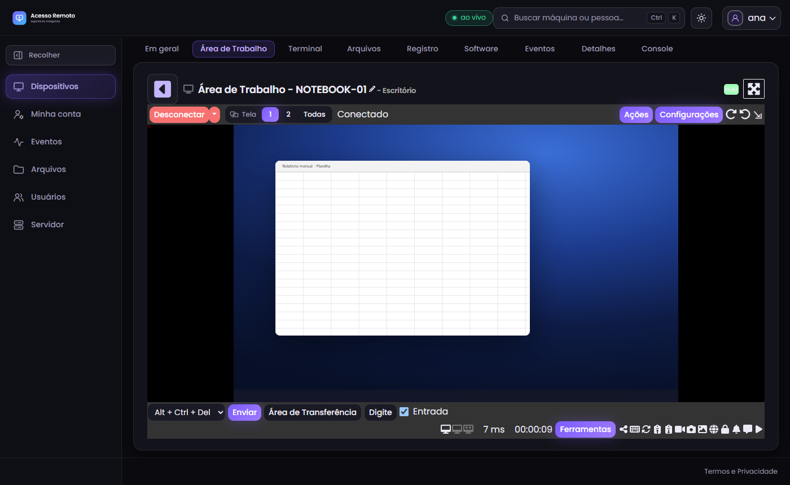
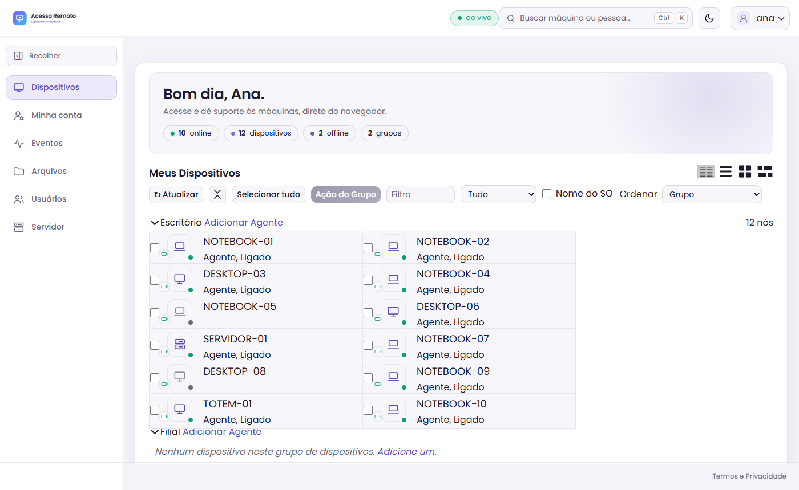
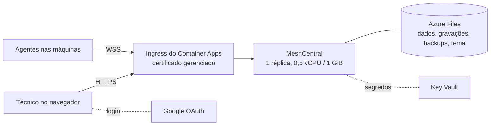

# Acesso remoto self-hosted no Azure

MeshCentral em Azure Container Apps, com Terraform, login pelo Google, sessões gravadas e uma
interface redesenhada (escuro e claro). Feito para substituir licenças de AnyDesk ou TeamViewer
por uma solução própria de baixo custo, acessada pelo navegador.

| Login | Dispositivos (escuro) |
|---|---|
|  |  |
| **Acesso remoto com seletor de tela** | **Dispositivos (claro)** |
|  |  |

*Capturas com dados fictícios.*

## O que tem aqui

- **Infra como código** (`terraform/`):
  - Container Apps no perfil Consumption, com 1 réplica fixa e certificado gerenciado;
  - Azure Files para dados, gravações e backups;
  - Key Vault para os segredos;
  - storage com replicação geográfica opcional, soft delete e trava contra exclusão.
- **Segurança:**
  - login pelo Google (cliente OAuth Interno, só contas da sua organização);
  - conta nova nasce sem acesso a nenhuma máquina;
  - 2FA obrigatório na conta local;
  - token de API desligado por padrão;
  - gravação de tela e terminal;
  - o usuário é avisado durante o atendimento.
- **Interface** (`terraform/theme/`), uma camada de CSS e JavaScript por cima do MeshCentral, sem fork:
  - modo escuro (padrão) e claro;
  - busca por máquina ou pela pessoa logada nela (`Ctrl K`);
  - saudação com contadores e botão Atualizar;
  - ícones de traço fino com status online/offline;
  - menu lateral recolhível;
  - seletor **Tela 1 · Tela 2 · Todas** no acesso remoto, que lembra a escolha por máquina.
- **Scripts Windows** (`scripts/windows/`):
  - instalação do agente em massa por qualquer RMM;
  - limpeza de outros acessos remotos e antivírus de terceiros, com travas de segurança.

## Arquitetura



O ingress termina o TLS e entrega HTTP na porta 80 (`tlsOffload`). O `config.json` do MeshCentral
é gerado pelo Terraform e gravado no Azure Files. Qualquer mudança no config ou no tema cria uma
revisão nova do container, que relê os arquivos.

## Custo

Estimativa de cerca de **R$ 70 por mês**:
- 1 réplica de 0,5 vCPU / 1 GiB ligada o tempo todo;
- storage GRS pequeno;
- Log Analytics com retenção de 30 dias.

O custo não cresce com o número de técnicos ou de máquinas. Para comparar: as licenças de mercado
para alguns técnicos ficam na faixa de US$ 90 a 120 por mês.

**Por que Container Apps e não VM:** as VMs baratas (série B) nem sempre estão disponíveis na região
ou na cota da assinatura. O Container Apps no perfil Consumption não depende de cota de VM, sai na
mesma faixa de custo e não tem sistema operacional para manter.

## Como subir

Pré-requisitos: Terraform 1.6+, Azure CLI logado e um domínio em que você possa criar registros DNS.

1. **State remoto:** copie `terraform/backend.hcl.example` para `backend.hcl` e aponte para uma storage sua.
2. **Variáveis:** copie `terraform/terraform.tfvars.example` para `terraform.tfvars` e preencha
   `subscription_id` e `hostname`. Na primeira subida, coloque o seu IP em `allowed_ips`.
3. **Aplicar:**
   ```bash
   cd terraform
   terraform init -backend-config=backend.hcl
   terraform apply
   ```
4. **DNS:** crie os registros das saídas `dns_cname` e `dns_asuid_txt`
   (`terraform output -raw dns_asuid_txt`).
5. **Domínio e certificado gerenciado:**
   ```bash
   az containerapp hostname add  -n <container_app_name> -g <resource_group_name> --hostname remoto.suaempresa.com.br
   az containerapp hostname bind -n <container_app_name> -g <resource_group_name> --hostname remoto.suaempresa.com.br \
     --environment <environment_name> --validation-method CNAME
   ```
6. **Primeira conta (vira admin):** abra o site e crie a conta. Use como senha o valor do segredo
   `meshcentral-admin-password` do Key Vault. Ative o 2FA logo em seguida.
7. **Abra para a internet:** volte `allowed_ips = []` e aplique. Os agentes precisam alcançar o servidor.

### Login pelo Google (opcional)

1. Crie no Google Cloud uma tela de consentimento do tipo **Interno** e um cliente OAuth do tipo
   **Aplicativo da Web**, com o redirecionamento da saída `google_callback_url`.
2. Preencha `google_client_id` e `google_client_secret` e aplique.
3. Cada pessoa entra uma vez pelo botão do Google. A conta nasce sem acesso, e o admin libera em
   **Usuários** e no grupo de dispositivos.
4. Quando todos tiverem permissão, use `show_password_login = false` para deixar só o Google na tela.

O MeshCentral não tem lista de e-mails permitidos para o login com Google. Para limitar quem entra,
restrinja o app a um grupo no Google Workspace: **Segurança → Controles de API → Controle de acesso
de apps**.

## Agente nas máquinas

1. No console, abra o grupo de dispositivos → **Adicionar agente** e copie o parâmetro `meshid` do
   link do Windows.
2. Rode `scripts/windows/instalar-agente.ps1` como SYSTEM pelo seu RMM:
   ```powershell
   -Server "https://remoto.suaempresa.com.br" -MeshId "<meshid do grupo>"
   ```
   O script é idempotente e pode rodar todo dia num perfil de automação, que também cobre as
   máquinas novas.
3. Se o editor de scripts do RMM só aceita colar texto e corrompe acentos, use as versões `-ascii`.

O `meshid` funciona como chave de cadastro: quem tem o valor consegue colocar uma máquina no grupo,
mas não acessar nenhuma. Não versione esse valor.

**Antivírus:** EDRs costumam bloquear o agente por detecção estática. Crie exclusões só para a
pasta do agente (`C:\Program Files\Mesh Agent\`) e para a pasta de instaladores
(`C:\ProgramData\AcessoRemoto\Instaladores\`). Restrinja ao motor estático, se o produto permitir.

**Limpeza** (`remover-acesso-remoto-e-antivirus.ps1`):
- por padrão só simula e lista o que encontrou; para remover, use `-Executar`;
- só remove acessos remotos se o agente do Mesh estiver rodando;
- só remove antivírus se o antivírus oficial (`-ServicosAntivirusOficial`) estiver rodando.

## Personalizar o tema

- **Cores:** os tokens ficam no início de `theme/theme.css` (`--rt-*`), um bloco para o modo
  escuro e outro para o claro.
- **Logos:** troque `logo-header.png` (texto claro), `logo-header-light.png` (texto escuro) e
  `logo-login.png`. Precisam ser PNG.
- **Textos do login e da saudação:** em `theme/theme.js`.
- **Ao atualizar o MeshCentral** (`meshcentral_version`), confira login, painel, página do
  dispositivo e diálogos nos dois modos, porque os seletores dependem do HTML dele.

## Operação

- **Atualizar o MeshCentral:** troque `meshcentral_version` e aplique.
- **Backups:** zip diário com senha (segredo `meshcentral-backup-zip-password`) no share
  `meshcentral-backups`, mais a replicação do storage.
- **Gravações:** ficam no share `meshcentral-recordings`, por `recording_days` dias.
- **Nunca recrie o share `meshcentral-data` sem backup:** ele guarda os certificados do servidor, e
  sem eles todos os agentes ficam órfãos. Por isso existe a trava `CanNotDelete`.

## Aprendizados

- **O filtro do MeshCentral é traduzido.** Em pt-BR, o operador `or` vira `o`. A busca usa vírgula
  (`texto,u:texto`), que funciona em qualquer idioma.
- **Telas:** na primeira conexão, a lista de telas chega antes de a interface ligar o
  `onDisplayinfo`, e o agente ignora a troca de tela antes de a sessão estar pronta. Por isso o
  `theme.js` acompanha a sessão e reenvia o pedido uma vez.
- **Arquivos de `meshcentral-web/public` só são lidos na inicialização.** O hash do tema entra numa
  variável de ambiente do container para gerar uma revisão nova.
- **O Azure Files só cria um diretório se o pai já existir.** Os diretórios do tema são criados em
  cadeia, com `depends_on`.

## Créditos e licenças

- [MeshCentral](https://github.com/Ylianst/MeshCentral) (Apache-2.0), usado pela imagem oficial,
  sem modificações.
- Fonte [Poppins](https://fonts.google.com/specimen/Poppins) (SIL OFL, em `theme/fonts/OFL.txt`).
- Ícones desenhados no estilo [Lucide](https://lucide.dev).
